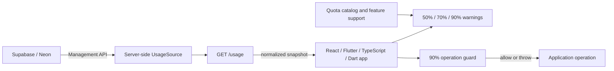

# Usage Limit Warnings

[](https://github.com/qalvinahmad/postgresql-free/actions/workflows/ci.yml)
[](LICENSE)

Reusable usage warnings and operation guards for free-tier PostgreSQL projects
on Supabase and Neon. Core packages are available for TypeScript, React, Dart,
and Flutter, with a server-side usage endpoint adapter.

> **Important:** This library does not enforce provider quotas globally. It
> guards only the operations you wrap, and it cannot stop a provider from
> charging, pausing, or suspending a resource. Provider usage data can be
> delayed or unavailable. Enforce guards on trusted servers and treat this
> library as a best-effort application safeguard—not a billing guarantee or
> availability SLA.

## Contents

- [Features](#features)
- [Architecture](#architecture)
- [Quick start](#quick-start)
- [Examples](#examples)
- [Provider lifecycle](#provider-lifecycle)
- [Free-tier quota catalog](#free-tier-quota-catalog)
- [Usage source and server](#usage-source-and-server)
- [Repository structure](#repository-structure)
- [Development](#development)
- [Limitations and safety](#limitations-and-safety)
- [Documentation and references](#documentation-and-references)

## Features

- Warning thresholds at **50%, 70%, and 90%**.
- Optional **90% hard stop** for operations explicitly wrapped with a guard.
- Equivalent threshold and operation-guard helpers for TypeScript and Dart.
- React warning hook and Flutter warning widget.
- Supabase project lifecycle status detection with explicit manual-resume guidance.
- Bounded retry for recognized Neon compute wake-up errors.
- Server-side provider credentials; never put management API keys in a client app.
- Unknown usage stays unavailable rather than being estimated or treated as zero.

## Architecture



The platform API and repository boundaries are described in the
[architecture guide](docs/architecture.md). Provider idle and recovery behavior
is covered in the [lifecycle guide](docs/provider-lifecycle.md).

## Quick start

Install the package you need from this monorepo or use the source paths while
developing locally. Package publishing is not configured yet.

### TypeScript

```ts
import {
  FREE_LIMITS,
  assertUsageAllowed,
  createUsageMetric,
  evaluateUsage,
  withUsageGuard,
} from "@usage-limit-warnings/typescript";

const metric = createUsageMetric(FREE_LIMITS.neon[0], 0.92);
const warning = evaluateUsage(metric);
console.log(warning?.threshold); // 90

try {
  await withUsageGuard(metric, () => saveDocument());
} catch (error) {
  if (error instanceof Error && error.name === "UsageLimitReachedError") {
    showQuotaMessage(error.message);
  } else {
    throw error;
  }
}

// For a synchronous check:
assertUsageAllowed(metric); // throws at >= 90%
```

Unavailable inputs (`usage: null` or `limit: null`) do not produce a warning
and do not trip the guard. Check `metric.available` and
`metric.unavailableReason` before relying on a guard for a cost-sensitive
operation.

### React

```tsx
import { useUsageWarnings } from "@usage-limit-warnings/typescript/react";
import type { UsageMetric } from "@usage-limit-warnings/typescript";

export function QuotaNotice({ metric }: { metric: UsageMetric }) {
  const warning = useUsageWarnings({
    metric,
    periodKey: "2026-10",
    onWarning: (event) => {
      // Send a toast/telemetry event. Persist your own deduplication state
      // if notifications must survive a page reload.
      console.warn(`${event.label}: ${event.threshold}%`);
    },
  });

  if (!warning) return null;
  return (
    <aside role="status">
      {warning.label}: {Math.round(warning.percent)}% used
      {warning.threshold >= 90 ? " — guarded operations are blocked" : ""}
    </aside>
  );
}
```

The hook reports threshold crossings for the current component lifetime. It
does not fetch or persist usage itself; supply fresh usage from your app/server.

### Dart and Flutter

```dart
import 'package:usage_limiter/usage_limiter.dart';

final limit = freeLimits[UsageProvider.neon]!
    .firstWhere((item) => item.id == UsageMetricId.egress);
final metric = UsageMetric(
  id: limit.id,
  label: limit.label,
  limit: limit.limit,
  unit: limit.unit,
  usage: 4.6,
  available: true,
  scope: limit.scope,
  period: limit.period,
);

await withUsageGuard(metric, () => saveDocument());
```

Flutter UI can render `UsageWarningBanner(metric: metric)` from
`package:usage_limiter_flutter/usage_limiter_flutter.dart`. Runnable examples
are in [`packages/usage-limiter-flutter/example`](packages/usage-limiter-flutter/example)
and [`examples`](examples).

## Examples

| Example | What it demonstrates |
| --- | --- |
| [`examples/typescript`](examples/typescript) | Build a usage metric and guard an operation |
| [`examples/react`](examples/react) | Show crossed warning thresholds in a React view |
| [`examples/server`](examples/server) | Keep provider credentials on a server and expose normalized usage |
| [`packages/usage-limiter-flutter/example`](packages/usage-limiter-flutter/example) | Flutter banner, Supabase resume guidance, and Neon wake retry |

See [integration recipes](docs/integrations.md) for deployment and polling
patterns.

## Provider lifecycle

Supabase Free may pause the **whole project** after around seven days of
insufficient user database activity. A paused project's database APIs and
dependent Auth may be unavailable until you manually resume it from Supabase
Dashboard. The documented restore window is up to one year.

Neon Free idles only the PostgreSQL compute after five minutes without active
queries. A new connection wakes it automatically, typically in a few hundred
milliseconds, though longer idle periods and cold caches can make the first
request slower. Stored data persists, but session-scoped state—such as
temporary tables, prepared statements, advisory locks, and `LISTEN`/`NOTIFY`
subscriptions—does not survive compute suspension.

The server source returns Supabase project lifecycle states. Use
`assertSupabaseProjectReady(project)`
to reject paused, degraded, or unknown status until application policy has
handled it. For Neon, use `withNeonWakeRetry(operation)` around safe connection
establishment; by default it retries recognized startup errors up to three
times with exponential backoff capped at one second.

**Do not ping Neon to keep it awake.** It wastes compute allowance and works
against scale-to-zero. See [provider lifecycle](docs/provider-lifecycle.md).

## Free-tier quota catalog

The code catalog is `FREE_LIMITS` in TypeScript and `freeLimits` in Dart. It
records metric scope and period as well as its limit. A catalog value is not
the same as an available live measurement.

| Quota | Supabase Free | Neon Free |
| --- | --- | --- |
| Database | 500 MB/project | 1 GB/project |
| Projects | 2/account | 100/account |
| Compute | 500 MB RAM/project (capacity, not metered usage) | 100 CU-hours/project/month |
| Egress | 5 GB/organization/month | 5 GB/project/month |
| File/object storage | 1 GB/organization | 5 GB/project |
| Monthly active users | 50,000 MAU/organization | Up to 60,000 MAU/project through Better Auth |
| Third-party active users | 50,000 MAU/organization | No separate allowance listed here |
| Realtime concurrent connections | 200/project | No built-in database realtime quota |
| Realtime messages | 2 million/organization/month | No built-in database realtime quota |
| Serverless invocations | 500,000 Edge Function invocations/organization/month | 1 million Node.js Function invocations/project/month |
| Branches | Plan/feature dependent; no fixed free limit asserted | 10/project |
| Node.js Function capacity | N/A | 10 active and 400 waiting capacity-hours/project/month |
| Instant restore | Paid-plan PITR not included | 6-hour restore window |

`FREE_FEATURES` / `freeFeatures` also describes PostgreSQL, Auth, Realtime,
REST, serverless functions, branching, logs, and restore feature availability.
Provider plan terms can change; see the linked official references before
relying on any limit.

## Usage source and server

`packages/usage-limiter-server` exports a Fetch-compatible `createUsageHandler`
and `createProviderUsageSource`. Provider API tokens belong in server secrets,
never in a React, Flutter, or other client bundle.

Built-in metrics are deliberately limited:

- Supabase Management API: project status and project count.
- Neon API: project count and per-project egress bytes.
- Metrics not returned by those APIs are represented as unavailable. Neon CPU
  seconds are not converted to CU-hours because they are different measures.

```ts
import { createUsageHandler } from
  "../../packages/usage-limiter-server/src/index.ts";
import { createProviderUsageSource } from
  "../../packages/usage-limiter-server/src/provider-source.ts";

const source = createProviderUsageSource({
  supabase: { accessToken: requiredEnv("SUPABASE_ACCESS_TOKEN") },
  neon: {
    apiKey: requiredEnv("NEON_API_KEY"),
    organizationId: requiredEnv("NEON_ORGANIZATION_ID"),
  },
});

export const fetch = createUsageHandler({
  source,
  allowedOrigins: ["https://app.example.com"],
});

function requiredEnv(name: string): string {
  const value = process.env[name];
  if (!value) throw new Error(`${name} is required.`);
  return value;
}
```

Replace the `process.env` pattern with your platform's secret bindings (for
example, Worker environment bindings). Configure authentication/rate limiting
on your endpoint as appropriate. A CORS allowlist is not authentication.
More details: [server integration guide](docs/integrations.md).

## Repository structure

```text
packages/
  usage-limiter-ts/       TypeScript core and React hook
  usage-limiter-dart/     Dart core, catalog, retry, and lifecycle helpers
  usage-limiter-flutter/  Flutter warning UI
  usage-limiter-server/   Fetch handler and provider adapters
examples/                 TypeScript, React, and server recipes
docs/                     Architecture, lifecycle, and integration guides
```

## Development

Requirements: Node.js 22+ and Dart/Flutter stable.

```sh
npm install
npm test
npm run typecheck

cd packages/usage-limiter-dart
dart pub get
dart analyze
dart run --enable-asserts test/usage_limiter_test.dart

cd ../usage-limiter-flutter
flutter pub get
flutter analyze
cd example
flutter pub get
flutter analyze
```

Contribution and issue-reporting guidance is in [CONTRIBUTING.md](CONTRIBUTING.md).
This project is licensed under the [MIT License](LICENSE).

## Limitations and safety

- Threshold guards use the usage sample supplied by the caller. They are not
  atomic quota reservations and cannot prevent usage that occurs between sample
  collection and the guarded operation.
- The 90% guard blocks only operations you explicitly wrap. It does not pause
  or disable a Supabase/Neon project.
- Unknown, stale, or unavailable usage cannot be assumed to be below a limit.
- Browser/mobile guards are bypassable. Apply important limits on a trusted
  server and validate authorization independently.
- Retry only connection establishment and idempotent/safe work. Do not
  automatically replay non-idempotent writes after ambiguous network failures.
- Built-in Supabase/Neon APIs do not provide every quota usage measurement.
- This project does not schedule keep-alive pings and does not provide an SLA.

## Documentation and references

- [Architecture and data flow](docs/architecture.md)
- [Provider idle, pause, and recovery](docs/provider-lifecycle.md)
- [Integration and deployment recipes](docs/integrations.md)
- [Supabase billing and quotas](https://supabase.com/docs/guides/platform/billing-on-supabase)
- [Supabase Realtime limits](https://supabase.com/docs/guides/realtime/limits)
- [Supabase Free project pausing](https://supabase.com/docs/guides/platform/free-project-pausing)
- [Neon Free plan](https://neon.com/blog/neon-free-plan-1-gb-per-project)
- [Neon compute lifecycle](https://neon.com/docs/introduction/compute-lifecycle)
- [Neon API: project details](https://api-docs.neon.tech/reference/getproject.md)
