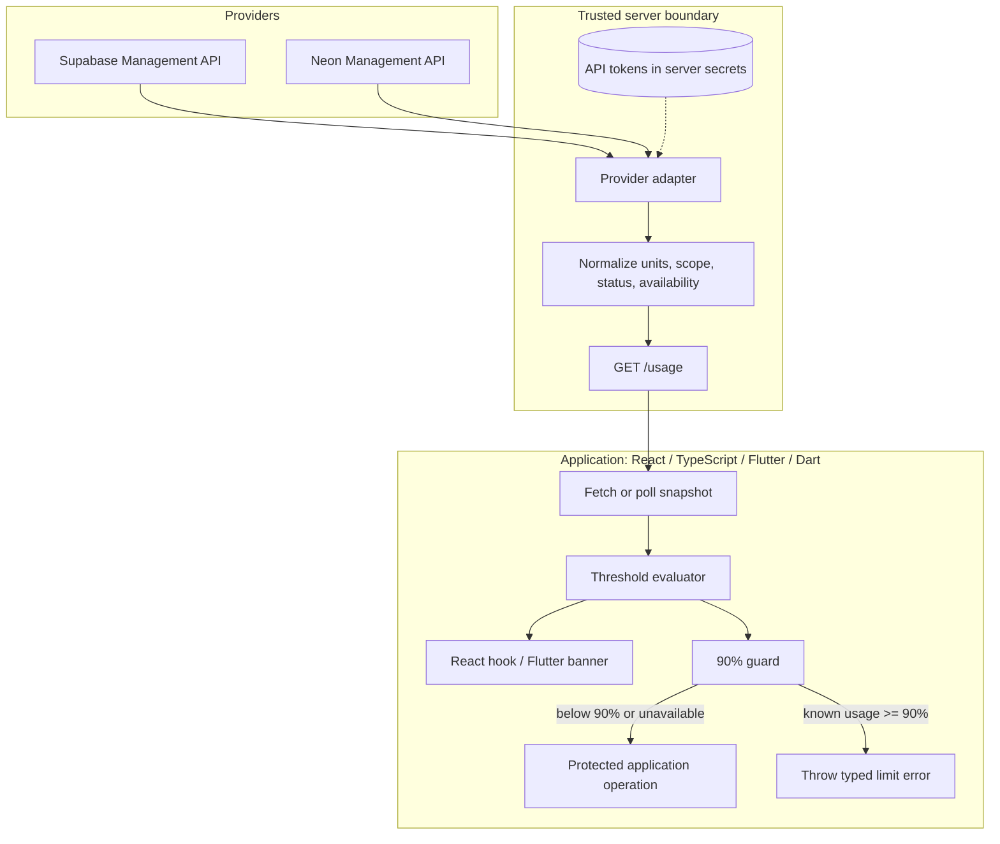

# Architecture

## Goals and non-goals

The library normalizes provider limits, evaluates usage supplied by an
application or a server-side adapter, and offers optional warning and
operation-guard helpers.

It is **not** a quota reservation service, billing control plane, provider
availability monitor, or substitute for provider-side controls. A usage
snapshot can be delayed and a guard cannot make sampling plus an operation
atomic.

## Components

### Package responsibilities

| Package | Responsibility |
| --- | --- |
| `usage-limiter-ts` | Quota/feature catalog, usage evaluation, threshold crossings, typed guard, Neon retry and Supabase lifecycle helpers, React hook |
| `usage-limiter-dart` | Dart catalog/evaluation, typed guard, Neon retry, Supabase lifecycle helpers |
| `usage-limiter-flutter` | Flutter warning presentation |
| `usage-limiter-server` | Fetch handler, provider credentials boundary, normalized provider snapshots |

## Data flow

1. The server adapter uses server-held credentials to read a provider API.
2. It maps values into a `UsageSnapshot`; a `UsageMetric` includes its limit,
   scope, unit, observation availability, and optional project `scopeId`.
3. Unsupported or missing measurements are explicitly represented as
   `available: false` and `usage: null`.
4. The application evaluates thresholds and displays warnings.
5. An application operation checks its relevant fresh metric before starting.
   At or above 90%, the guard throws. It never pauses a provider project.

## Trust and freshness

Management credentials must not be sent to clients. CORS only controls which
browsers can read a response; it does not authenticate users. Protect the
usage endpoint with your app's authentication and authorization as needed.

Consumers should associate a snapshot with a provider, project/account scope,
and billing period. For high-risk operations, refresh immediately before the
operation and enforce on the server. Even then, concurrent usage can exceed a
threshold between sampling and completion; this helper does not lock provider
quota.

Neon usage metrics can lag. Supabase status and quota reporting can also be
eventually consistent. Unknown is never a claim of zero usage or a guarantee
that the project is ready.

## Failure behavior

- Provider request failures are surfaced as an HTTP 502 from the supplied
  handler; they do not produce a successful-looking empty snapshot.
- A Supabase status that is paused, unhealthy, or unknown fails the
  `assertSupabaseProjectReady` helper closed.
- Neon retries are limited to recognized compute wake errors, and only when
  explicitly wrapped.
- Unknown quota usage does not generate a false threshold warning. The app
  should decide whether a missing measurement should disable a sensitive
  feature.
